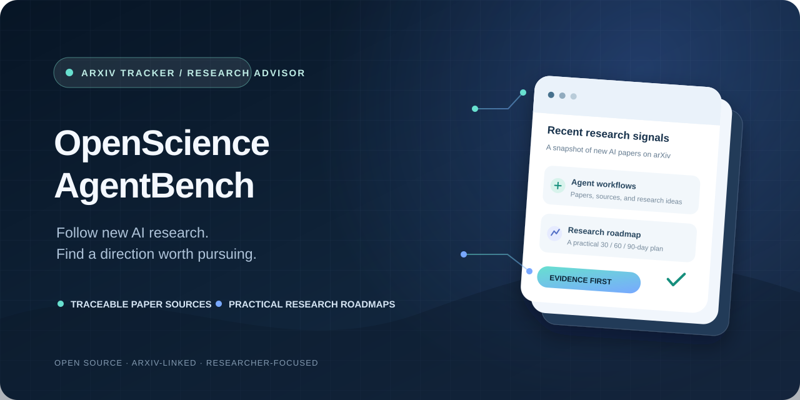
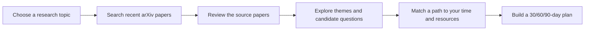

<div align="center">

<h1>OpenScienceAgentBench</h1>

<p><strong>From recent AI papers to a research direction you can pursue</strong></p>

<p>Search arXiv, inspect the source papers, and build a practical research plan around your skills, time, and compute.</p>

<p><a href="#quick-start">Get started</a> · <a href="docs/deployment.md">Run the web app</a> · <a href="docs/research-methodology.md">Read the research methods</a></p>

<p>
  <a href="https://github.com/nadiw1245/OpenScienceAgentBench/actions/workflows/update-arxiv-digest.yml"></a>
  <a href="LICENSE"></a>
  <a href="https://www.python.org/"></a>
  <a href="https://streamlit.io/"></a>
</p>



</div>

OpenScienceAgentBench combines live arXiv discovery, an optional AI research advisor, a daily paper digest, and a command-line workflow. It helps new researchers get oriented and plan a feasible first project. Model suggestions are starting points for human review.

## What it does

- **Find papers:** search a topic phrase or browse a broad recent sample from selected AI-focused arXiv categories.
- **Explore directions:** ask about themes, methods, limitations stated by authors, and possible follow-up questions.
- **Plan a project:** get several research paths and a personalized 30/60/90-day plan that accounts for time, skills, compute, data, and mentorship.
- **Inspect sources:** review the exact paper records and abstracts supplied to the model, with direct arXiv links.
- **Track new releases:** publish an automatically refreshed digest in Markdown and JSON.
- **Choose a model:** use Gemini, Hugging Face Inference Providers, or OpenAI with your own key.

## How it works



## Start the web app

Requirements: Python 3.10 or newer.

```powershell
python -m venv .venv
.\.venv\Scripts\Activate.ps1
python -m pip install -r requirements.txt
streamlit run app.py
```

In the app, choose a model provider, enter your own provider key, select a supported model, and search. The arXiv search does not need an API key. The AI synthesis does.

To publish a browser-accessible instance from this GitHub repository, follow the [Streamlit deployment guide](docs/deployment.md).

### Model providers and costs

| Provider | Key | Cost and data notes |
| --- | --- | --- |
| Gemini | [`GEMINI_API_KEY`](https://aistudio.google.com/app/apikey) | Eligible models may have a limited free tier; quotas and terms can change. Google marks free-tier content as usable to improve its products. |
| Hugging Face Inference Providers | [`HF_TOKEN`](https://huggingface.co/settings/tokens) and a provider-supported model ID | Hugging Face currently lists **$0.10/month** in credits for Free users, subject to change. Requests beyond available credits may require payment. |
| OpenAI | [`OPENAI_API_KEY`](https://platform.openai.com/api-keys) | API usage is billed separately from ChatGPT subscriptions. |

Check the providers' [current Gemini terms and pricing](https://ai.google.dev/gemini-api/docs/pricing) and [Hugging Face Inference Providers pricing](https://huggingface.co/docs/inference-providers/pricing) before use. Keys entered into a hosted app are processed by its server; the selected model provider receives your question, profile, and retrieved abstracts. See [deployment and data handling](docs/deployment.md). Never commit API keys.

## Ask from the command line

The CLI uses live arXiv search by default. Set a provider key in your shell, then run:

```powershell
$env:GEMINI_API_KEY = "your-api-key"
python scripts/research_advisor.py "What direction should I explore?" `
  --topic "AI agents" `
  --background "Beginner Python, undergraduate mathematics" `
  --constraints "5 hours per week, no GPU" `
  --goal "Choose a reproducible starter project" `
  --once
```

Use another provider by setting its environment variables and selecting it:

```powershell
$env:HF_TOKEN = "your-hugging-face-token"
$env:HF_MODEL = "provider/model-name"
python scripts/research_advisor.py "Suggest a research path" --topic "AI agents" --provider huggingface --once
```

The included CLI and digest use Python's standard library. To ask about the saved digest instead of querying arXiv live, add `--source digest`. See [advisor usage and evidence limits](docs/research-advisor.md).

## Latest papers

- [Browse the latest digest](docs/latest.md)
- [Download the paper metadata](data/latest.json)
- [How evidence is recorded](docs/evidence-policy.md)
- [How the system works](docs/architecture.md)
- [Research methods and limitations](docs/research-methodology.md)
- [Deployment instructions](docs/deployment.md)
- [Project roadmap](docs/roadmap.md)

The default digest covers first submissions from the preceding three days in `cs.AI`, `cs.LG`, `cs.CL`, `cs.CV`, `cs.RO`, `cs.NE`, and `stat.ML`. Refresh it locally with:

```powershell
python scripts/update_digest.py
```

The scheduled workflow runs daily at 08:00 UTC and can also be run from **Actions → Update arXiv digest → Run workflow**. Repository settings must allow Actions to write contents for scheduled commits to work.

## Important limitations

- A live search returns a limited arXiv metadata sample from the chosen categories and date window. It is not all of arXiv, all scholarly literature, or a systematic review.
- The advisor reads titles and abstracts, not full papers. Suggested gaps are hypotheses; novelty needs a broader literature search and human review.
- Theme labels are simple keyword tags. They do not establish that a research area is growing or that a paper is high quality.
- A GitHub URL in arXiv metadata is a source link, not evidence that code reproduces reported results. The project does not run paper code.
- Model-generated summaries can be incomplete or wrong. Check the linked papers and provider terms.

See the [research methodology](docs/research-methodology.md) and [evidence policy](docs/evidence-policy.md) for details.

## Repository contents

```text
app.py                              Streamlit web interface
scripts/research_advisor.py         Live arXiv search and model-backed CLI
scripts/update_digest.py            Daily digest generator
data/latest.json                    Machine-readable latest digest
docs/latest.md                      Human-readable latest digest
.github/workflows/                  Scheduled digest update
docs/                               Setup, methods, evidence, deployment, roadmap
```

## Contribute and cite

Issues and focused pull requests are welcome. Start with [CONTRIBUTING.md](CONTRIBUTING.md); report vulnerabilities using [SECURITY.md](SECURITY.md). Read [CODE_OF_CONDUCT.md](CODE_OF_CONDUCT.md) for community expectations. Citation metadata is in [CITATION.cff](CITATION.cff); the project is MIT-licensed.

If you share the project, show one real query and its source papers, and invite feedback on retrieval quality and usefulness. No repository can guarantee stars or research impact.
