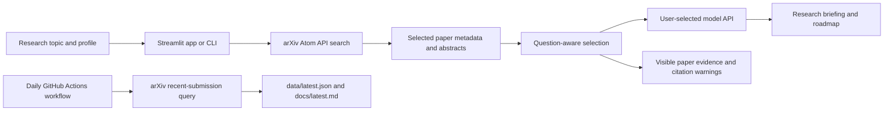

# Architecture

OpenScienceAgentBench has a live search and advisor, a local command-line interface, and a daily digest workflow. arXiv is the paper metadata source; the user chooses which model provider interprets the selected records.

## Live discovery

`scripts/research_advisor.py` owns the arXiv search, provider requests, paper ranking, evidence formatting, and CLI. `app.py` supplies a Streamlit interface to the same retrieval and model functions. A topic search uses arXiv's `all:` field, selected categories, and a bounded date window. Broad mode samples recent submissions from the chosen categories. Results are capped, requests are spaced, and the app caches identical searches briefly.

The selected paper context includes arXiv IDs, direct record links, dates, categories, repository links found in arXiv metadata, and clipped abstracts. The model receives the user question and researcher profile with that context. The app shows which records it supplied and flags citations outside that record set.

## Daily digest

`scripts/update_digest.py` queries selected arXiv categories for first submissions in a rolling window. It stores the query and UTC generation time alongside the paper metadata. A GitHub URL is included as an arXiv-linked repository only when the URL appears in the paper's abstract or author comment. Otherwise, title-search links remain labeled suggestions.

The scheduled GitHub Actions workflow refreshes the digest and commits changed JSON and Markdown files to `main`. It does not invoke a language model or require a model-provider secret.

## Trust boundaries

- arXiv provides paper metadata; the system does not score peer review, paper quality, or research impact.
- Retrieved abstracts are untrusted source text, not instructions to the model.
- arXiv search results are bounded and relevance-ranked or recent. Search coverage is incomplete and cannot establish novelty.
- Keyword counts and ranking are heuristics; a single result set cannot demonstrate growth over time.
- At inference time, paper metadata, abstracts, and the user prompt/profile leave the local machine and go to the chosen model provider. Review that provider's data policy.
- A source check is a warning, not formal citation verification. The project does not execute code or reproduce papers.
